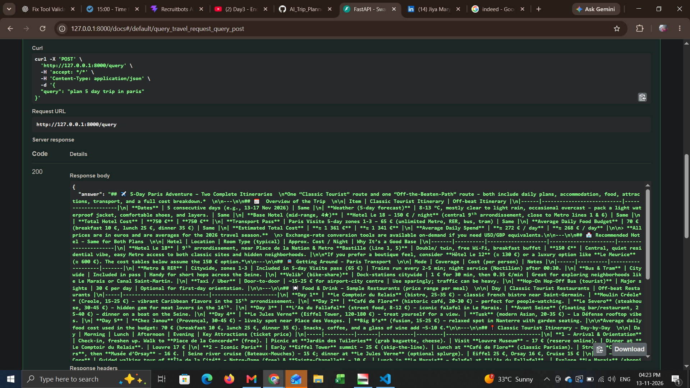
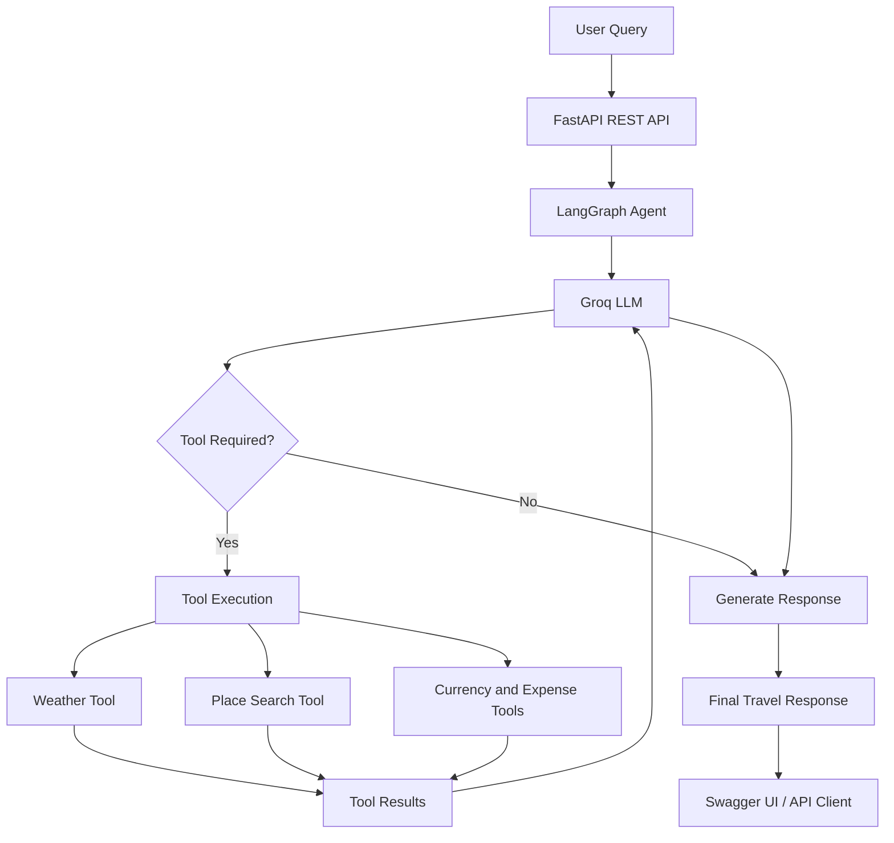

# 🌍 AI Trip Planner – Agentic AI Application

An AI-powered travel planning application built using **Agentic AI, LangGraph, and Large Language Models (LLMs)**. It helps users plan trips by intelligently coordinating multiple tools to retrieve travel information, explore destinations, check weather forecasts, convert currencies, and estimate travel expenses.

The application uses an agent-based workflow where an LLM understands user requests, selects appropriate tools, processes their results, and generates contextual travel recommendations.

## 🚀 Key Features

- **AI-Powered Travel Planning:** Generate travel plans based on destination and trip duration.
- **Agentic Workflow:** Uses LangGraph to orchestrate LLM interactions and tool execution.
- **Weather Information:** Retrieve weather forecasts for travel destinations.
- **Place Search:** Discover tourist attractions, restaurants, activities, and transportation options.
- **Currency Conversion:** Convert expenses between different currencies.
- **Expense Calculation:** Calculate total expenses and daily travel budgets.
- **External API Integration:** Retrieve real-world information through external services.
- **REST API:** Expose travel planning functionality through FastAPI.
- **Swagger UI:** Interactively test API endpoints using automatically generated API documentation.

## 🧠 Agent Architecture

The application follows an agentic workflow powered by LangGraph.

1. The user submits a travel-related query through the FastAPI endpoint.
2. The LLM interprets the request and determines the required actions.
3. The agent selects appropriate tools based on the user's requirements.
4. Tools execute their respective operations and retrieve information.
5. Tool results are returned to the LLM.
6. The LLM processes the results and generates a contextual travel response.
7. FastAPI returns the final response to the user.

### Workflow Diagram



## 🛠️ Technology Stack

| Category | Technologies |
|---|---|
| Programming Language | Python |
| LLM Provider | Groq |
| LLM Framework | LangChain |
| Agent Orchestration | LangGraph |
| Backend Framework | FastAPI |
| API Documentation | Swagger UI (OpenAPI) |
| Place Search | OpenStreetMap, Nominatim, Overpass API |
| Weather | Weather API integration |
| Currency Conversion | Exchange Rate API |
| Testing | Pytest |
| Environment Management | Python Virtual Environment, uv |
| Version Control | Git, GitHub |

## 📂 Project Structure

```text
AI-Trip-Planner/
│
├── agent/
│   ├── graph_builder.py
│   └── ...
│
├── agentic_workflow/
│   └── agentic_workflow.py
│
├── tools/
│   ├── weather_info_tool.py
│   ├── place_search_tool.py
│   ├── currency_converter_tool.py
│   └── expense_calculator_tool.py
│
├── utils/
│   ├── weather_info.py
│   ├── currency_converter.py
│   └── expense_calculator.py
│
├── tests/
│   ├── test_weather_info_tool.py
│   ├── test_currency_converter.py
│   └── ...
│
├── config/
│   └── ...
│
├── main.py
├── requirements.txt
├── pyproject.toml
├── .env.example
├── .gitignore
└── README.md
```

*Note: Update the directory structure to reflect your actual repository.*

## ⚙️ Installation and Setup

### 1. Clone the repository

```bash
git clone https://github.com/DataBird-Savvy/AI-Trip-Planner.git

cd AI-Trip-Planner
```

### 2. Create a virtual environment

Using uv:

```bash
uv venv env
```

Activate the environment on Windows:

```bash
env\Scripts\activate
```

### 3. Install dependencies

```bash
uv pip install -e .
```

Alternatively:

```bash
pip install -r requirements.txt
```

### 4. Configure environment variables

Create a `.env` file in the project root.

```env
GROQ_API_KEY=your_groq_api_key
EXCHANGE_RATE_API_KEY=your_exchange_rate_api_key
```

Add other API keys if required by your configured services.

**Important:** Never commit your `.env` file or expose API keys in GitHub.

### 5. Run the FastAPI application

Start the application using Uvicorn:

```bash
uvicorn main:app --reload
```

### 6. Access Swagger UI

Once the FastAPI application is running, open:

**Swagger UI:**

http://localhost:8000/docs

**ReDoc:**

http://localhost:8000/redoc

Use Swagger UI to:

- Explore available API endpoints.
- View request and response schemas.
- Submit travel planning queries.
- Execute API requests interactively.
- Inspect API responses and errors.

## 💬 Example User Queries

Submit travel-related queries through the Swagger UI interface.

**Example 1: Travel Planning**

```json
{
    "question": "Plan a trip to Goa for 5 days"
}
```

**Example 2: Destination Exploration**

```json
{
    "question": "Plan a 4-day trip to Paris with popular tourist attractions and restaurants"
}
```

**Example 3: Weather Information**

```json
{
    "question": "What is the weather forecast in London?"
}
```

**Example 4: Currency Conversion**

```json
{
    "question": "Convert 100 EUR to USD"
}
```

*Note: Request fields should match the Pydantic schema defined in your FastAPI application.*

## 🧪 Testing

Pytest is used to test application components and verify expected behavior.

Run all tests:

```bash
pytest
```

Run a specific test file:

```bash
pytest tests/test_weather_info_tool.py -v
```

Run tests with detailed output:

```bash
pytest -v
```

Testing helps identify issues in tool registration, API integrations, input validation, data processing, and error handling.

## 🔍 Key Learning Outcomes

Through this project, I explored and implemented:

- Building agentic AI applications using LangGraph.
- Integrating LLMs with external tools through function calling.
- Designing modular and reusable tools.
- Integrating third-party REST APIs.
- Developing RESTful backend services using FastAPI.
- Exploring API endpoints using Swagger UI.
- Handling tool execution and workflow errors.
- Working with OpenStreetMap and open-source geospatial services.
- Writing automated tests using Pytest.
- Managing API credentials and application configuration.

## 🔮 Future Enhancements

- Add Retrieval-Augmented Generation (RAG) for travel knowledge.
- Implement conversational memory to retain user preferences.
- Generate optimized multi-day travel itineraries.
- Add hotel and flight search integrations.
- Introduce Docker-based deployment.
- Improve agent evaluation and response reliability.


